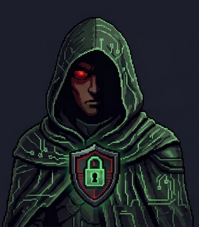

<div align="center">


# Ecossistema SoftwareHub

### Um time de agentes de IA, cada um especialista em sua area — instalavel em qualquer CLI


</div>

---

## O time

<table>
<tr>
<td align="center" width="33%">
<a href="https://github.com/WallysonDuarte/agente-master">
<br/>
<b>⚡ MASTER</b>
</a><br/>
<sub><b>Full Stack Developer</b></sub><br/>
<sub>5 skills</sub><br/><br/>

</td>
<td align="center" width="33%">
<a href="https://github.com/WallysonDuarte/agente-nova">
<br/>
<b>🎯 NOVA</b>
</a><br/>
<sub><b>Product Owner</b></sub><br/>
<sub>5 skills</sub><br/><br/>

</td>
<td align="center" width="33%">
<a href="https://github.com/WallysonDuarte/agente-atlas">
<br/>
<b>🧪 ATLAS</b>
</a><br/>
<sub><b>QA Engineer</b></sub><br/>
<sub>5 skills</sub><br/><br/>

</td>
</tr>
<tr>
<td align="center" width="33%">
<a href="https://github.com/WallysonDuarte/agente-pixel">
<br/>
<b>🎨 PIXEL</b>
</a><br/>
<sub><b>UI/UX Designer</b></sub><br/>
<sub>5 skills</sub><br/><br/>

</td>
<td align="center" width="33%">
<a href="https://github.com/WallysonDuarte/agente-forge">
<br/>
<b>🔧 FORGE</b>
</a><br/>
<sub><b>Arquitetura de Software</b></sub><br/>
<sub>5 skills</sub><br/><br/>

</td>
<td align="center" width="33%">
<a href="https://github.com/WallysonDuarte/agente-cipher">
<br/>
<b>🔐 CIPHER</b>
</a><br/>
<sub><b>Seguranca da Informacao</b></sub><br/>
<sub>5 skills</sub><br/><br/>

</td>
</tr>
<tr>
<td align="center" width="33%">
<a href="https://github.com/WallysonDuarte/agente-luna">
<br/>
<b>🌙 LUNA</b>
</a><br/>
<sub><b>Marketing Digital</b></sub><br/>
<sub>5 skills</sub><br/><br/>

</td>
<td align="center" width="33%">
<a href="https://github.com/WallysonDuarte/agente-lira">
<br/>
<b>✍️ LIRA</b>
</a><br/>
<sub><b>Redacao Criativa</b></sub><br/>
<sub>5 skills</sub><br/><br/>

</td>
<td align="center" width="33%">
<a href="https://github.com/WallysonDuarte/agente-rank">
<br/>
<b>📊 RANK</b>
</a><br/>
<sub><b>SEO Specialist</b></sub><br/>
<sub>5 skills</sub><br/><br/>

</td>
</tr>
</table>

| Agente | Papel | Skills | O que faz |
|---|---|---|---|
| ⚡ **[Master](https://github.com/WallysonDuarte/agente-master)** | Full Stack Developer | 5 | Implementa features de ponta a ponta — backend, frontend, banco e publicacao — e so considera a entrega concluida quando ela esta rodando e verificada. |
| 🎯 **[Nova](https://github.com/WallysonDuarte/agente-nova)** | Product Owner | 5 | Transforma intencao de negocio em especificacao executavel: desenho da solucao, criterios verificaveis e prioridade justificada por valor. |
| 🧪 **[Atlas](https://github.com/WallysonDuarte/agente-atlas)** | QA Engineer | 5 | Valida a entrega de verdade: automatiza o fluxo, exercita os erros e produz laudo com evidencia. |
| 🎨 **[Pixel](https://github.com/WallysonDuarte/agente-pixel)** | UI/UX Designer | 5 | Desenha e implementa interface com sistema de design consistente, responsiva de verdade e acessivel por padrao — nao por correcao posterior. |
| 🔧 **[Forge](https://github.com/WallysonDuarte/agente-forge)** | Arquitetura de Software | 5 | Define a estrutura que sustenta o sistema: camadas, limites, integracoes e desempenho — com a decisao registrada antes do codigo. |
| 🔐 **[Cipher](https://github.com/WallysonDuarte/agente-cipher)** | Seguranca da Informacao | 5 | Audita, endurece e responde. |
| 🌙 **[Luna](https://github.com/WallysonDuarte/agente-luna)** | Marketing Digital | 5 | Constroi aquisicao mensuravel: canal, oferta, rastreamento e campanha — com numero antes e depois, nao impressao. |
| ✍️ **[Lira](https://github.com/WallysonDuarte/agente-lira)** | Redacao Criativa | 5 | Escreve o que precisa ser lido: artigo, pagina de venda, mensagem e roteiro — com estrutura antes do texto e revisao antes da publicacao. |
| 📊 **[Rank](https://github.com/WallysonDuarte/agente-rank)** | SEO Specialist | 5 | Faz o site ser encontrado: desempenho tecnico, rastreabilidade, intencao de busca e autoridade — medidos na ferramenta do buscador, nao no palpite. |

---

## O que cada repositorio contem

```
agente-<nome>/
├── AGENT.md                 definicao canonica do agente
├── .agent/agent.json        metadados legiveis por maquina
├── skills/<slug>/SKILL.md   uma skill por arquivo, autocontida
├── install/README.md        instalacao nas 8 CLIs
└── assets/portrait.png
```

Cada `SKILL.md` traz **quando usar**, principios, procedimento, checklist, antipadroes e criterio de
pronto. E autocontido: funciona isolado, sem o resto do repositorio.

---

## Como funciona o fluxo

```
Nova (Product Owner)
   |  desenha a atividade, define criterios de aceite verificaveis
   v
Master (Full Stack) ---> implementa, publica, verifica
   |  encaminha o que deve ser testado
   v
Atlas (QA) ---> executa, produz laudo com evidencia
   |
   +-- aprovado --> entrega concluida
   +-- reprovado -> volta para Master com passos de reproducao
```

Os demais entram sob demanda:

| Agente | Quando entra |
|---|---|
| Pixel | interface nova, sistema de design, acessibilidade, responsividade |
| Forge | decisao arquitetural, desempenho, integracao, divida tecnica |
| Cipher | auditoria, endurecimento, segredos, incidente |
| Luna | aquisicao, campanha, rastreamento, e-mail |
| Lira | artigo, pagina de conversao, roteiro, revisao |
| Rank | busca organica, desempenho tecnico, autoridade |

---

## Instalacao

```bash
git clone https://github.com/WallysonDuarte/agente-master.git
cd agente-master

# Claude Code — skills nativas
cp -r skills/* ~/.claude/skills/

# Qualquer outra CLI — arquivo unico de instrucao
cat AGENT.md skills/*/SKILL.md > AGENTS.md
```

| CLI | Instalacao (Windows / PowerShell) | Onde colocar as skills | Rodar |
|---|---|---|---|
| **Claude Code** | `irm https://claude.ai/install.ps1 | iex` | `~/.claude/skills/` | `claude -p "<pedido>"` |
| **Codex** | `irm https://chatgpt.com/codex/install.ps1 | iex` | `AGENTS.md na raiz do projeto` | `codex exec --skip-git-repo-check "<pedido>"` |
| **Grok** | `irm https://x.ai/cli/install.ps1 | iex` | `passado no prompt` | `grok -p "<pedido>"` |
| **Antigravity** | `irm https://antigravity.google/cli/install.ps1 | iex` | `passado no prompt` | `agy -p "<pedido>"` |
| **Hermes** | `iex (irm https://hermes-agent.nousresearch.com/install.ps1)` | `passado no prompt` | `hermes` |
| **OpenClaw** | `& ([scriptblock]::Create((iwr -useb https://openclaw.ai/install.ps1))) -NoOnboard` | `~/.openclaw/skills/` | `openclaw agent --local -m "<pedido>"` |
| **OpenCode** | `irm https://opencode.ai/install | iex` | `AGENTS.md na raiz do projeto` | `opencode` |
| **Kimi Code** | `irm https://code.kimi.com/kimi-code/install.ps1 | iex` | `passado no prompt` | `kimi -p "<pedido>"` |

Cada repositorio traz o passo a passo completo por CLI em `install/README.md`.

---

<div align="center">

## Apoie este trabalho

Os 9 agentes sao mantidos de forma independente e publicados abertamente.
Se este material te poupou tempo, voce pode retribuir com um cafe:

<a href="https://buy.stripe.com/bJefZi3wJ4JH18WeuEgA800">

</a>

## Links

[](https://www.linkedin.com/in/dududev/)
[](https://dozeroaojunior.com.br/)
[](https://curitibasoftware.com.br/)
[](https://softwarehub.com.br/)


</div>


